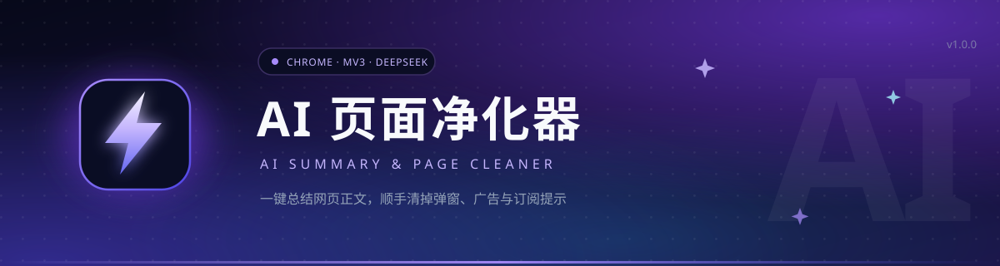
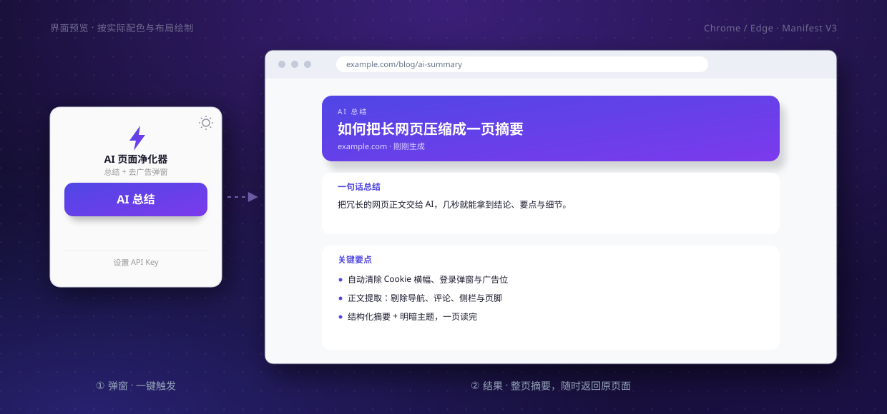
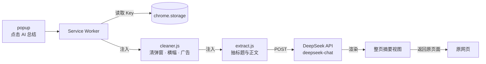

<div align="center">



<br />

**一键把任何网页，变成一页 AI 摘要。**

自动清除弹窗 · Cookie 横幅 · 订阅提示 · 广告位 · 滚动锁定


</div>

---

## 🧭 这是什么？

**AI 页面净化器**是一个 Chrome / Edge 扩展（Manifest V3）。点一下图标，它会：

1. **先打扫**——清掉页面上的 Cookie 同意条、登录/注册弹窗、订阅提示和广告位，顺手解开被锁住的滚动条；
2. **再抽取**——自动点开「展开全文」，克隆页面剔除导航、页脚、评论、侧栏，只留下正文（最多 30000 字符）；
3. **最后总结**——把标题与正文交给 DeepSeek，生成「一句话总结 + 关键要点 + 详细总结」；
4. **换上干净的一页**——用整页的极简视图展示结果，支持明暗主题，随时「返回原页面」。

没有自建服务器，没有埋点统计。API Key 与网页内容，只在你自己的浏览器和 DeepSeek 之间流转。

> 写它的原因很简单：想读一篇文章，却要先关掉两个弹窗、点掉一个 Cookie 横幅、滑过三屏推荐位——这不该是阅读的代价。

---

## ✨ 功能特性

| | 特性 | 说明 |
| :--: | :--- | :--- |
| ⚡ | **一键总结** | 弹窗一个按钮，不用复制粘贴正文 |
| 🧩 | **三段式摘要** | 一句话结论（≤50 字）+ 3–8 条要点 + ≤500 字详解 |
| 🧹 | **自动净化** | 关键词 + CSS 选择器双重启发式，覆盖主流弹窗与广告位 |
| 📄 | **正文抽取** | `og:title` → `h1` → `document.title` 三级取标题，剔除结构噪音 |
| 🔍 | **展开全文** | 自动触发「展开」「阅读更多」「read more」等按钮 |
| 🛟 | **兜底策略** | 过滤后正文不足 50 字符时，退回逐文本节点遍历 |
| 🎨 | **沉浸式结果页** | 卡片排版 + 轻量 Markdown 渲染，明暗主题一键切换 |
| 🔌 | **自定义接口** | 支持代理 / 中转地址，适配网络受限环境 |
| 💬 | **友好报错** | 未配置 Key、正文过少、接口异常都有具体原因和「返回原页面」 |

---

## 🖥️ 界面预览



左边是扩展弹窗，右边是点击后整页替换的摘要视图——原文随时可以点「返回原页面」找回来。

---

## 🚀 快速开始

### 1. 安装

本扩展未上架应用商店，需要以开发者模式加载：

```text
① 下载 / 克隆本仓库
② 打开 chrome://extensions（Edge 为 edge://extensions）
③ 打开右上角「开发者模式」
④ 点击「加载已解压的扩展程序」，选择本文件夹
⑤ 在扩展菜单里把「AI 页面净化器」固定到工具栏
```

### 2. 配置 API Key

右键扩展图标 → **选项**（或点弹窗底部「设置 API Key」）：

| 配置项 | 说明 | 默认值 |
| :--- | :--- | :--- |
| DeepSeek API Key | 以 `sk-` 开头，可在 [platform.deepseek.com](https://platform.deepseek.com/api_keys) 创建 | 空 |
| API 地址（可选） | 支持代理 / 中转根地址，不要带 `/v1` | `https://api.deepseek.com` |

> ⚠️ 使用自定义 API 地址时，必须把该域名加入 `manifest.json` 的 `host_permissions`，否则请求会被浏览器拦截（默认只放行 `https://api.deepseek.com/*`）。

### 3. 使用

打开任意文章页 → 点击图标 → 点 **AI 总结** → 等几秒 → 阅读摘要 → 点 **返回原页面** 回到原文。

输出长这样：

```markdown
## 一句话总结
文章用三个实验说明：写作的瓶颈不在词句，而在结构。

## 关键要点
- 先列大纲，再填内容
- 每段只讲一件事
- 用具体例子替代形容词

## 详细总结
作者先回顾了常见的写作误区，随后用三组对照实验……
```

---

## 🧠 工作原理



几个实现细节：

- **总结在后台完成**：`popup` 只负责派发任务就关闭，注入与请求由 Service Worker 执行，即使弹窗关闭流程也会继续。
- **渲染函数直接注入页面**：`showLoading` / `showSummary` / `showError` 通过 `chrome.scripting.executeScript` 序列化后在目标页执行，样式内联，不依赖也不污染原页面 CSS。
- **净化持续生效**：`cleaner.js` 注册了 `MutationObserver`，页面后插入的弹窗也会被清理。
- **Markdown 是轻量自实现**：正则处理标题、列表、加粗、代码块，并非完整解析器，复杂语法可能渲染不完美。
- **模型参数**：`deepseek-chat`，`temperature: 0.3`，`max_tokens: 2000`。

---

## 📦 项目结构

```
AI总结浏览器网页插件/
├── manifest.json          # MV3 清单：权限、入口、图标
├── background.js          # Service Worker：调用 DeepSeek、注入脚本、渲染结果
├── content/
│   ├── cleaner.js         # 页面净化：Cookie / 登录 / 订阅弹窗、广告、滚动锁定
│   └── extract.js         # 正文抽取：展开全文、去噪、标题与文本提取
├── popup/
│   ├── popup.html         # 工具栏弹窗
│   └── popup.js           # 派发任务、检查 API Key、主题切换
├── options/
│   ├── options.html       # 设置页
│   └── options.js         # 保存 / 加载 API Key
├── assets/                # README 配图
└── icons/                 # 16 / 48 / 128 图标
```

---

## 🔐 权限与隐私

| 权限 | 用途 |
| :--- | :--- |
| `activeTab` | 点击图标后临时获得当前标签页访问权，用于注入脚本 |
| `scripting` | 注入 `cleaner.js`、`extract.js` 与渲染函数 |
| `storage` | 保存 API Key、API 地址与主题偏好 |
| `host_permissions` | 仅放行 `https://api.deepseek.com/*`，用于发起总结请求 |

- 扩展**不包含任何统计、埋点或自建后端**；
- API Key 只存在扩展存储中，仅用于以 `Authorization: Bearer` 请求你配置的接口；
- 被总结的网页标题与正文（截断至 30000 字符）会发送给 DeepSeek，**请避免在涉密页面使用**；
- 网页内容仅在本地内存处理，不会上传到其他第三方。

---

## ⚠️ 已知限制

- **受保护页面无法使用**：`chrome://`、`edge://`、扩展管理页、Chrome 应用商店、PDF 内置阅读器。
- **自定义地址要改权限**：`host_permissions` 未包含该域名时，请求会被浏览器拦截。
- **抽取是启发式的**：Shadow DOM、`iframe` 内嵌正文、登录后才可见的内容可能抓不到，会提示字符数不足。
- **自动点击可能误触**：文本含「展开」「read more」的元素若本身是跳转链接，可能把页面带走。
- **净化可能误伤**：广告/Cookie 判断基于关键词与选择器，少数站点可能被误删区块，刷新即可恢复。
- **长文会截断**：只取前 30000 字符，超长文章后半部分不参与总结。
- **代码块被排除**：`<pre>` / `<code>` 在去噪阶段被移除，技术文章的示例代码不会进入摘要。
- **主题不同步**：在摘要页切换主题只写入该页 `localStorage`，不会回写扩展设置。
- **持续监听有开销**：`cleaner.js` 的观察器会运行到页面刷新，频繁变动的页面会有少量性能消耗。
- **会产生费用**：每次总结调用一次 DeepSeek 接口，按官方计费规则扣除额度。

---

## ❓ FAQ

**Q：点击「AI 总结」没反应？**<br>
A：先看弹窗底部是否提示「请先设置 API Key」，再确认当前不是 `chrome://` 等受保护页面。接口错误会显示在页面上，而不是弹窗里。

**Q：提示「无法从该页面提取任何文字内容」？**<br>
A：正文可能在登录墙后、`iframe` / Shadow DOM 中，或页面本身是图片、视频。登录或滚动加载后重试。

**Q：提示「仅提取到 N 个字符」？**<br>
A：有效正文少于 50 字符，通常是被弹窗遮挡或未加载完，刷新后重试。

**Q：接口报 401 / 402 / 429？**<br>
A：401 一般是 Key 无效，402 是余额不足，429 是触发限流，稍后重试。

**Q：能用第三方中转吗？**<br>
A：可以。在设置页填写中转根地址（不带 `/v1`），并把该域名加入 `manifest.json` 的 `host_permissions`。

**Q：会上传我的浏览记录吗？**<br>
A：不会。只有你主动点击总结时，当前页的标题与正文才会发送给 DeepSeek。

---

## 🗺️ Roadmap

- [ ] 流式输出（SSE）与会话内历史记录
- [ ] 选中段落局部总结 / 多语言输出
- [ ] 摘要收藏与导出（Markdown / PDF）
- [ ] 基于 Readability 的正文抽取，替代现有启发式规则
- [ ] 快捷键与右键菜单入口

---

## 📜 许可与免责

本项目暂未附带 `LICENSE` 文件；正式开源分发前建议补充一个（例如 MIT）。

- 与 DeepSeek 官方无关联，调用产生的一切费用由使用者自行承担；
- 摘要由大模型生成，可能存在偏差或遗漏，请勿作为事实依据；
- 扩展会删除页面元素以保证可读性，该操作不可撤销，刷新页面即可恢复原样。

---

<div align="center">

**如果它帮你省下了三分钟，点个 ⭐ 就好。**

<sub>Made with Chrome Extensions API · DeepSeek · 一点点 CSS 执念</sub>

</div>
